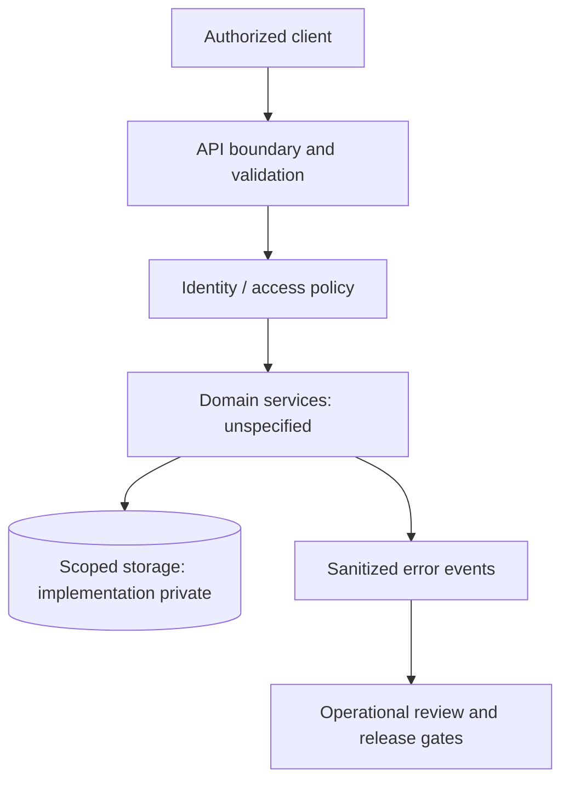

# IVSI — Platform Architecture and Systems Engineering Notes — Reference Architecture

## What is known

The public description only identifies IVSI as a software platform/system-design project. The acronym, business domain, implementation language and live service status are **not independently established** by this repository.

## Engineering question

Documenting a platform in a way that distinguishes real product requirements from reusable backend-design patterns while keeping unknown business details explicitly unclaimed.

## Illustrative flow (not a production diagram)

## Design invariants and risk controls

- Document actual user roles and domain events only after confirming source-of-truth requirements.
- Place authorization at service/data boundaries, never trust client-supplied entity scope.
- Define exactly what error/availability metrics can be published without exposing sensitive data.
- Treat retries, idempotency and migrations as design risks; do not assert their implementation without tests.

## Synthetic scenario to test in future

Illustrative only: a request arrives with an unauthorized resource identifier; the policy layer should deny it before reaching data access, and a sanitized event should be recorded.

## Failure mode / trade-off

Overly specific public diagrams for a confidential platform can both misrepresent the implementation and disclose internal assumptions.

## Evidence required before confirming features

- A versioned implementation artifact or test contract, reviewed against original source.
- A deterministic fixture that exercises negative permissions, errors and recovery.
- A dated CI run linked to the fixture rather than to documentation formatting alone.
- Authorized sanitized images/measurements; never actual account or customer data.

This file should be updated when real evidence becomes publishable; until then these are **design notes only**. See [README.md](README.md) and [ROADMAP.md](ROADMAP.md).
